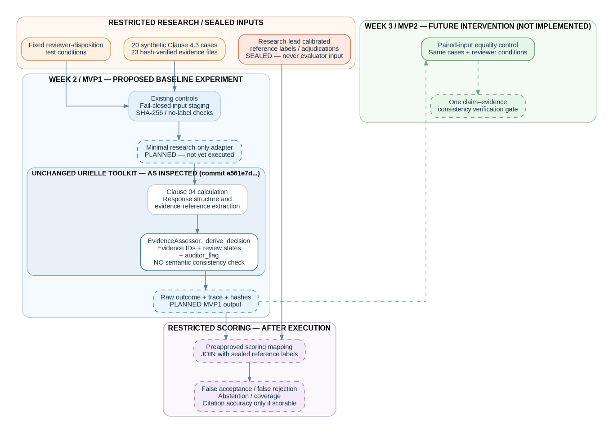

# Urielle AIMS Audit Reliability — Architecture & Design (v1.0)

**6 November 2026 | OdySEA Fall 2026 | Clause 4.3 / C4-Q03**

## Verified as-is baseline

The unchanged toolkit at candidate SHA `a561e7d9f73cecb0ccd7d0823dfc481bc5a7ea37` extracts evidence IDs and derives a deterministic decision through `EvidenceAssessor._derive_decision` from evidence IDs, integrity-review dispositions and `auditor_flag`. No claim–evidence semantic check was established in the inspected path.

| Condition | Operational result |
| --- | --- |
| No evidence IDs | `NOT_EVIDENCED` |
| All refs accepted, no auditor flag | `EVIDENCED` |
| At least one accepted ref otherwise | `PARTIALLY_EVIDENCED` |
| Otherwise | `REQUIRES_HUMAN_JUDGEMENT` |

Operational `EVIDENCED` is not semantic ground truth.

## Data and trust boundary

- Restricted archive: original calibration records, adjudication and calibrated labels; never evaluator inputs.
- Evaluator-only staging: 20 synthetic cases, 23 verified evidence files, fixed review-condition inputs. Benchmark remains **NOT_FROZEN**.
- Proposed Week 2 research-only adapter: invoke original toolkit and capture raw response, trace, IDs, reviewer conditions, SHA and environment. **Not yet implemented / executed.**
- Restricted post-run scoring: apply preapproved mapping, then join sealed labels; report actual metrics with denominators.
- Proposed Week 3 consistency gate: run one isolated claim–evidence check on paired identical inputs, comparing with unchanged baseline. **Not implemented.**

## Components already implemented and published

| File | Function |
| --- | --- |
| `src/stage_evaluator.py` | Fail-closed evaluator-only staging / leakage controls |
| `src/paired_input_gate.py` | Compare matched input records before Week 3 comparison |
| `src/verify_calibration_logs.py` | Verify restricted log integrity/completeness |
| `tests/test_operational_controls.py` | Public control tests (7 pass, 6 benchmark-dependent skips) |

Internal Week 1 operational-control tests: 13/13 passed, as recorded in `validation/TEST_RESULTS.md`. No 20-case baseline has been executed.

## MVP1 release gates

1. Restore and verify original restricted reviewer CSV provenance.
2. Approve the prospective scoring amendment and exact baseline-state mapping.
3. Document toolkit commit and practical execution environment.
4. Run one real C4-Q03 smoke test through the unchanged toolkit.
5. Capture and seal raw outcomes across 20 cases, then perform post-run scoring.

## Research limits

Reference labels are research-lead calibrated, not independently blinded human ground truth. The dataset is synthetic and limited to one AIMS clause/question. The inspected path is deterministic and does not establish an LLM semantic reasoning step. No findings from Week 2 or Week 3 have been measured as of this design baseline.

## Repositories

- Research: https://github.com/wholidi/Urielle-AIMS-Audit-Reliability
- Original toolkit: https://github.com/wholidi/Urielle-ISO42001-AIMS-Toolkit
